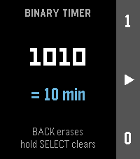
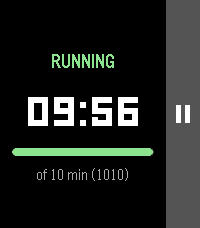
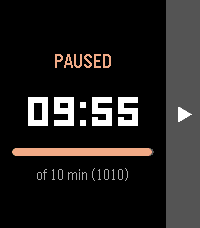
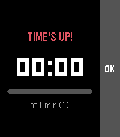

# pebble-timer-binary
A Pebble Core Time 2 timer application that uses binary to enter the duration.

Instead of a "+1 minute" button, you type the number of minutes in binary:
UP enters a `1`, DOWN enters a `0`. For example, 1, 0, 1, 0 is 10 minutes.

**[▶ Try it in your browser](https://developer.repebble.com/pebbleos/docs/playground/?pbw=https://raw.githubusercontent.com/ebensh/pebble-timer-binary/main/demo/pebble-timer-binary.pbw)**
(runs the real app in the PebbleOS Playground; pick Pebble Time 2 if asked).

| Entering 1010 | Running | Paused | Done |
|---|---|---|---|
|  |  |  |  |

## Controls

| Screen | UP | DOWN | SELECT | BACK |
|---|---|---|---|---|
| Entry | add `1` | add `0` | start (hold: clear) | erase last bit; exit when empty |
| Running / paused | | | pause / resume | cancel back to entry |
| Time's up | | | back to entry | back to entry |

Up to 10 bits (1023 minutes). When time is up the watch vibrates and lights
up. If you leave the app while the timer is running, it schedules a wakeup so
the alarm still goes off.

## Build and run

Requires the [Pebble SDK](https://developer.repebble.com/sdk).

```bash
pebble build
pebble install --emulator emery     # or: pebble install --phone <ip>
```

`demo/pebble-timer-binary.pbw` is a prebuilt copy used by the browser demo;
refresh it with `cp build/pebble-timer-binary.pbw demo/` after changes.
